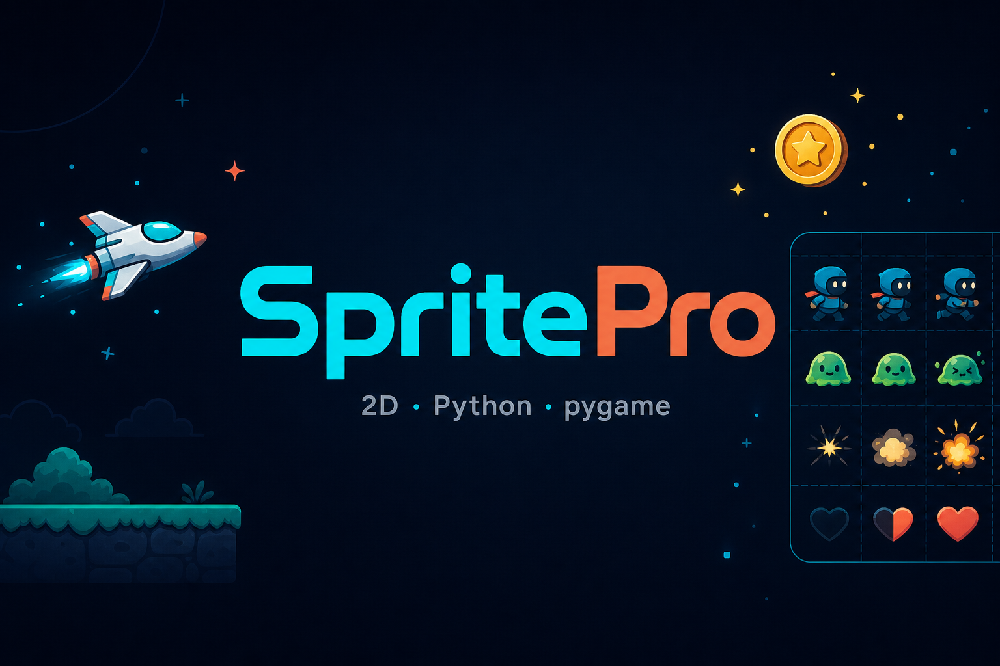
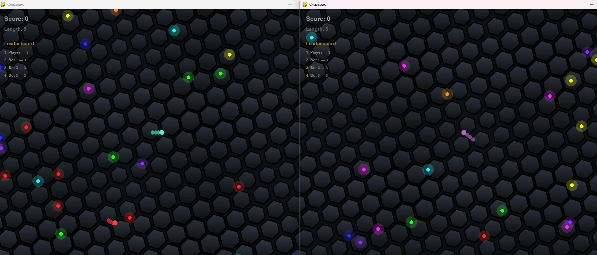

# SpritePro

A high-level 2D game framework for Python (on top of pygame). Desktop, web and mobile from one codebase.

[](https://www.python.org/)
[](LICENSE)
[](CHANGELOG.md)




---

## Installation

```bash
pip install spritepro
```

For mobile: `pip install "spritepro[kivy]"`

Project template: `python -m spritePro.cli --create` (minimal: `--create --simple`)

### Updating

```bash
pip install --upgrade spritepro
```

---

## Why SpritePro

| What you usually do | In SpritePro |
|---------------------|--------------|
| Hand-written game loop | `s.run(scene=...)` — scene + auto-render |
| Your own camera | Camera API, follow, zoom, shake |
| UI from scratch | `Button`, `ToggleButton`, `TextSprite`, `Slider`, `TextInput`, `Layout` |
| Physics kept separate | `pymunk` integration, body types, collisions |
| Visual editor | Sprite Editor → JSON → `spawn_scene(...)` |
| Parsing saves by hand | `PlayerPrefs` → JSON |
| Multiplayer from scratch | TCP, lobby, ChatScene, sync |
| Mobile as a separate thing | `platform="kivy"` — same logic |
| Scrollable UI | `ScrollView` + `ClipMask` — clipping that already works |

**SpritePro = pygame + physics, Layout, ScrollView, ClipMask, scene editor, multiplayer, UI.**

---

## Quick start

```python
import spritePro as s

class MainScene(s.Scene):
    def __init__(self):
        super().__init__()
        self.player = s.Sprite("", (50, 50), s.WH_C, speed=5, scene=self)

    def update(self, dt):
        self.player.handle_keyboard_input()

s.run(scene=MainScene, size=(800, 600), title="My Game")
```

That's it: window, scene, game loop, controls.

---

## What's inside

- **Sprite** — the base class, with movement, effects and a parent-child hierarchy
- **UI**: Button, ToggleButton, Slider, TextInput, TextSprite, Layout (flex/grid/circle/line)
- **ClipMask** — a clipping mask for viewports, inventories, chats
- **ScrollView** — scrollable content with a wheel and drag-and-drop
- **Physics**: pymunk, DYNAMIC/STATIC/KINEMATIC bodies, collisions
- **Animations**: Tween, Fluent API (`DoMove`, `DoScale`, `SetEase`...)
- **Particles**: ParticleEmitter, presets, pools
- **Multiplayer**: TCP, lobby, ChatScene, sync
- **Audio**: sound and music
- **Save/Load**: PlayerPrefs as JSON
- **Sprite Editor**: build scenes visually → JSON

---

## Sprite Editor

A visual scene editor with a hierarchy, an inspector and gizmos.


```
python -m spritePro.cli --editor
```

Build a scene → save it as JSON → load it in the game:

```python
rt = spawn_scene("level.json", scene=self)
player = rt.exact("player").Sprite(speed=5)
```

---

## Multiplayer chat

A ready-made chat scene with a clipping mask and scrolling:

```python
from spritePro.readyScenes import ChatScene, ChatStyle
import spritePro as s

s.run(scene=ChatScene, multiplayer=True, multiplayer_use_lobby=True, title="Chat")
```

---

## Comparison

| Feature | pygame | arcade | SpritePro |
|---------|--------|--------|-----------|
| Auto-render | ❌ | ✅ | ✅ |
| Ready-made camera | ❌ | ✅ | ✅ |
| Physics (pymunk) | ❌ | ✅ | ✅ |
| Layout (flex/grid) | ❌ | ❌ | ✅ |
| Scene editor (JSON) | ❌ | ❌ | ✅ |
| Clipping mask / ScrollView | ❌ | ❌ | ✅ |
| Multiplayer (TCP) | ❌ | ❌ | ✅ |
| PlayerPrefs | ❌ | ❌ | ✅ |

---

## What to build

- Platformers, arcades, RPGs
- Puzzles, tower defense
- Multiplayer games
- Mobile games (`platform="kivy"`)

---

## Demo games

```bash
python -m spritePro.demoGames.physics_demo       # physics
python -m spritePro.demoGames.fluent_tween_demo   # tweens
python -m spritePro.demoGames.layout_demo         # layouts
python -m spritePro.demoGames.local_multiplayer_demo --quick
```

### Slizario (andrulok)

A multiplayer clone of [Slither.io](https://slither.io/) and the reference networked game on SpritePro: host-authoritative food and bots, actions confirmed by the host, joining mid-game. Architecture walkthrough in [ARCHITECTURE.md](spritePro/demoGames/slisario_andrulok/ARCHITECTURE.md).



```bash
# single player
python spritePro/demoGames/slisario_andrulok/main.py --single

# local: host + client, two windows
python spritePro/demoGames/slisario_andrulok/main.py --quick
```

More: [spritePro/demoGames/slisario_andrulok/README.md](spritePro/demoGames/slisario_andrulok/README.md)

[All 54 demos](docs/demo_games/demo_games.md)

---

## Mobile and Web

```python
s.run(scene=MainScene, platform="kivy")  # Android/iOS
```

```bash
python -m spritePro.cli --android . --android-orientation portrait
```

Web: [docs/builds/building_web.md](docs/builds/building_web.md)

---

## Documentation

| What | Where |
|------|-------|
| Full index | [DOCUMENTATION_INDEX.md](DOCUMENTATION_INDEX.md) |
| Table of contents for `docs/` | [docs/README.md](docs/README.md) |
| API Reference | [docs/API_REFERENCE.md](docs/API_REFERENCE.md) |
| For beginners | [docs/GETTING_STARTED.md](docs/GETTING_STARTED.md) |
| Physics | [docs/core/physics_guide.md](docs/core/physics_guide.md) |
| UI/Layout | [docs/ui/layout_ui.md](docs/ui/layout_ui.md) |
| ClipMask | [docs/ui/clip_mask.md](docs/ui/clip_mask.md) |
| Multiplayer | [docs/systems/networking_guide.md](docs/systems/networking_guide.md) |
| Sprite Editor | [docs/editor/sprite_editor.md](docs/editor/sprite_editor.md) |
| Mobile | [docs/builds/mobile_kivy.md](docs/builds/mobile_kivy.md) |

---

## Contributing

- [CONTRIBUTING.md](CONTRIBUTING.md) — how to contribute
- [ROADMAP.md](ROADMAP.md) — roadmap
- [CHANGELOG.md](CHANGELOG.md) — changelog

---

[📖 Documentation](DOCUMENTATION_INDEX.md) · [💬 GitHub Issues](https://github.com/NeoXider/SpritePro/issues)
